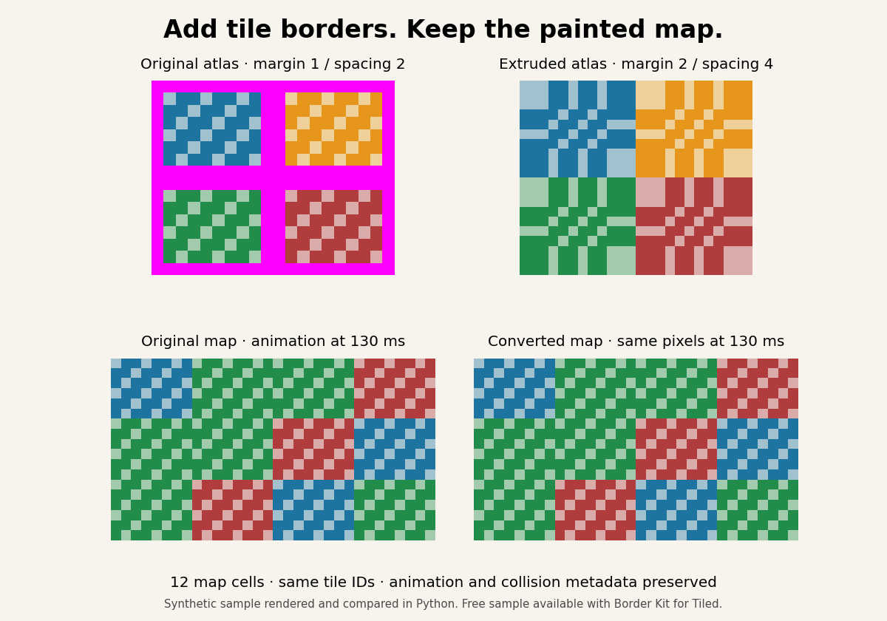

# Border Kit for Tiled — free sample

Compare an existing Tiled map before and after adding a two-pixel extruded border to its tileset. The tile IDs, animation frames and collision objects remain attached to the same tiles.

The comparison above is rendered from the downloadable synthetic sample, not an editor screenshot. The four tile interiors and all 12 map cells match pixel for pixel at 0, 130 and 275 ms; the border changes the atlas layout. Open the sample in Tiled to inspect the animation and collision object yourself.

## Open the sample

1. [Download the free sample ZIP](Border-Kit-Free-Sample.zip?raw=true) and extract it.
2. Open `original/sample.tmx` in [Tiled](https://www.mapeditor.org/).
3. Open `bordered/sample.tmx` and compare the map, animated tile and collision object.
4. Inspect the two PNG atlases. Each tile in the bordered sheet has its own edge pixels duplicated around it.

Keep the extracted directory structure intact. Each map uses relative paths to its tileset and image.

## Why the margin and spacing change

For a tightly packed rectangular sheet with a two-pixel border, the new outer margin is 2 px and the spacing between tile interiors is 4 px. The width and height of each tile stay the same. When a sheet already has a margin or spacing, the output geometry must account for that layout too.

Extrusion can help with texture sampling across neighbouring tiles. Check the result in your game, since camera rounding, scaling and other renderer settings can also produce seams.

## Do you need the paid converter?

For a new map, or a single image you are happy to configure by hand, a free extruder may be enough. [Tile Extruder](https://github.com/sporadic-labs/tile-extruder#using-the-extruded-tileset) documents a PNG workflow followed by changing the image, margin and spacing in Tiled. [ToolPkg's tileset slicer](https://www.toolpkg.com/tileset-slicer) advertises free extrusion and TSX export. These are documented alternatives, not tools we have independently tested.

Border Kit is a convenience option for an **existing external TSX**: it reads that file, replaces its image reference and geometry in a copy, and retains the tile metadata. It does not make extrusion itself exclusive, and it does not guarantee a seam-free game.

Before choosing a workflow:

- Keep the column count and tile order unchanged; changing either can change which artwork an existing tile ID selects.
- Compare custom properties, animation frame IDs/durations and collision shapes after conversion.
- Work in a project copy and keep the external TSX path unchanged when replacing it. Other assets may depend on relative paths.
- Test in your engine at the camera zoom and filtering settings you actually use. A matching map in Tiled does not prove every rendering issue is fixed.

[Tiled's tileset documentation](https://doc.mapeditor.org/en/stable/manual/editing-tilesets/) explains image grids, margin, spacing and per-tile information. The free sample above lets you inspect our output before spending anything.

## Convert your own PNG and TSX

[Border Kit for Tiled is available for $4 on itch.io](https://frenkitchio.itch.io/border-kit-for-tiled). The paid download includes a Python CLI that converts the image and a copy of the external TSX together, a guide and regression checks. It supports single-sheet rectangular grids, Python 3.10+, Pillow 9.1+ and a filesystem supporting hard links. PNGs must be at most 8 bits per channel. The CLI was tested on Linux.

This repository contains the free inspection sample. Download the converter through the store page to apply the conversion to your own compatible tileset.

## Verification and feedback

The sample's 12 cells were compared pixel by pixel after extraction, including animation and collision metadata. A separate synthetic map was also checked through Tiled's official Linux rasterizer. Interactive desktop use and customer maps have not been verified.

If you find a problem in this sample, open an issue with the Tiled version, map filename, expected result and observed result. Share only files you have permission to publish.

Code, documentation, cover and synthetic sample assets were produced with generative AI assistance.
